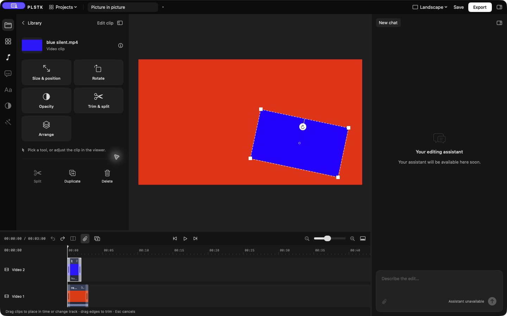
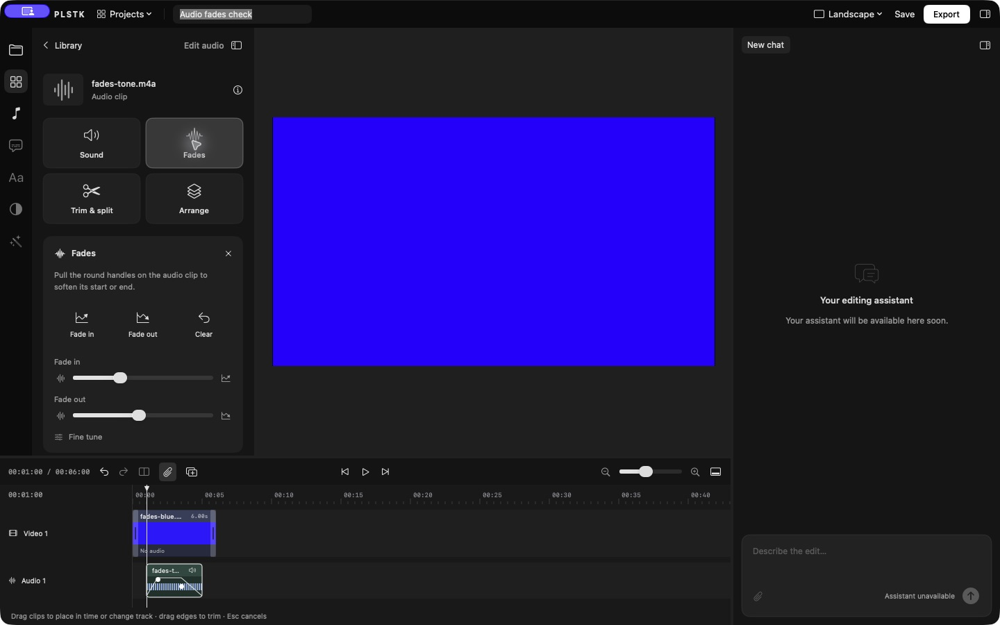

# PLSTK

A local video editor for macOS, built for people who want to make a good edit without working through a wall of settings.

PLSTK is pronounced like plastic. The idea is simple: bring in your footage, shape it on the timeline, and export it on your own Mac. Everyday controls use icons, visual handles, and simple presets. Exact settings are there when you need them, tucked into Fine tune.

Core editing does not require an account or a subscription. Preview and export run locally. PLSTK does not add a watermark, impose an export quota, or place output sizes behind a paid plan.



## Project status

PLSTK is in active development. The editing workflow works today, but this is an early version rather than a finished production editor.

The current installation path is to build the app from source. A self contained, signed and notarized download is still planned. FFmpeg and ffprobe must currently be installed separately.

Development and testing currently take place on Apple silicon. Intel support has not yet been verified.

## What you can do

### Build an edit

Import video, audio, PNG images, and JPEG images into your Library. Preview an asset before adding it to the timeline, then arrange clips where you want them.

The timeline supports up to 32 visual tracks and two independent audio lanes. Visual layers can overlap, clips can leave gaps, and audio can extend beyond the video. Higher visual layers appear above lower ones.

Move, trim, split, duplicate, and remove visual clips. Move, trim, split, and remove audio clips. Editing actions support undo and redo.

### Work visually

Select a clip to open its toolbox. Use Size & position, Rotate, Opacity, Trim & split, Sound, and Arrange as appropriate for the selected media.

Drag a clip in the viewer to reposition it. Pull a corner to resize it, or use its circular handle to rotate it. Fit, Inset, Centre, and rotation buttons provide quick starting points.

Transparent PNG images can sit over footage. Opacity lets the layer below show through, making room for logos, overlays, and layered compositions. Still images also have simple duration presets.

Fine tune opens exact values for the option you selected. Back to Library returns to browsing, and selecting the same timeline clip opens its controls again.

### Add titles

Open Text and choose Simple, Statement, or Caption. A five second title appears at the playhead above the overlapping visual layers. Type your words, choose a color, and use Top, Centre, or Bottom to place them quickly.

Use Edit text in the viewer to change the wording without returning to the sidebar. Viewer handles surround the title itself and support moving, resizing, and rotating. Exact size and text alignment live inside Fine tune.

Titles are editable content stored inside the project. No generated image or separate font file needs to travel with the edit. You can trim, split, duplicate, move, or adjust the opacity of a title. Split parts and duplicates can be edited independently. A title can also form a standalone card on a black background.

The Caption preset is a manual text style with a contrasting plate. Automatic transcription and timed caption generation are still planned. Titles currently use system typography, three color choices, and up to eight lines. Long text wraps and shrinks to fit.

### Shape the sound

Independent audio clips support volume, mute, fade in, and fade out. Choose a fade preset, use a slider, or pull the circular handles on the timeline. Exact durations are available in Fine tune.

Fades stay continuous when you split a clip during a ramp. Moving a clip keeps its fade settings. Separate audio lanes can overlap for music and voice, or for opposing fades.



### Preview and export

Timeline playback uses a local AVFoundation composition and updates after edits. Seek with the ruler, step through frames, and use the viewer to check placement and layering.

Export produces an MP4 with H.264 video and AAC audio at 30 frames per second. Canvas presets include landscape, portrait, and square. Detailed output choices include landscape 720p, 1080p, and 4K, along with portrait and square formats.

If macOS cannot preview a format directly, Playback > Render Preview provides a local FFmpeg fallback. Export also uses FFmpeg.

Cancelling or failing an export preserves an existing destination file. The app also refuses to export over a source asset.

## Requirements

1. macOS 14 or newer.
2. Xcode with Swift 6 or newer and an active command line toolchain.
3. FFmpeg and ffprobe with support for libx264 and AAC.
4. Python 3 if you want to run the rendering smoke test.

No external Swift packages are currently required. The app uses SwiftUI, AppKit, AVFoundation, CoreGraphics, and ImageIO alongside the local media tools.

## Build and open

With Homebrew already installed, install the media tools:

```sh
brew install ffmpeg
```

Clone the repository and build the app:

```sh
git clone https://github.com/FVTVLIX/PLSTK.git
cd PLSTK
bash scripts/build-app.sh
open "Build/PLSTK.app"
```

The build script creates a local app bundle and applies an ad hoc signature. That signature is for development and does not represent a notarized public release.

See [Building PLSTK](docs/BUILDING.md) for additional development instructions.

## Make your first edit

1. Use Import media or press ⌘I. Your files appear in the Library without being inserted automatically.
2. Click an asset to preview it, then choose Add to timeline.
3. Move or trim clips directly on the timeline. Click its ruler to set the playhead and use the scissors button to split.
4. Select a clip and choose a tool. Use the viewer handles or a preset for visual adjustments, or open Fine tune for exact settings.
5. Add music or another sound, then adjust its volume and fades.
6. Save the project with ⌘S and export an MP4 with ⌘E.

## Your projects and media

Project files use the `.localvideo` extension and store the edit rather than copies of your media. Original files remain in their existing locations.

Paths are relative when an asset is beneath the project folder, and absolute otherwise. Keep source files available. If a file moves, return to the Library and use Relink media.

Saving an existing project keeps its previous saved version in a backup file. Opening, closing, or replacing an unsaved project prompts before discarding edits.

PLSTK also keeps a separate local recovery copy after a brief pause in editing and when the app moves into the background. After an unexpected quit, choose Recover to restore that edit, Not Now to leave it for later, or Discard Copy to remove it. File > Recover Unsaved Edit lets you return to a deferred copy.

Recovered edits open as unsaved projects. Saving asks for a destination and suggests a name ending in “recovered,” so your original saved project stays unchanged. Media files remain in their existing locations and can be relinked if needed. Recovery does not restore undo history or replace regular saving. Edits made immediately before an unexpected quit may not yet be in the recovery copy.

Recovery copies stay in the local Application Support folder for PLSTK. Copies belonging to another running editor are left alone. If a copy cannot be read, it stays on disk. A warning appears if recovery becomes unavailable, with options to retry or show the recovery folder.

The current project format is version 8. Earlier versions open with migration defaults that preserve their existing timing and visual settings. Older app versions may not open projects saved by newer versions.

## Keyboard shortcuts

| Action | Shortcut |
| :--- | :--- |
| Import media | ⌘I |
| Open a project | ⌘O |
| Save | ⌘S |
| Export | ⌘E |
| Undo | ⌘Z |
| Redo | ⇧⌘Z |
| Play or pause | Space |
| Step through frames | Left or Right |
| Jump to the beginning or end | ⌘Left or ⌘Right |
| Split at the playhead | B |
| Toggle snapping | S |
| Mute the selected clip | M |
| Duplicate a visual clip | ⌘D |
| Toggle the left panel | [ |
| Toggle the assistant panel | ] |
| Toggle the timeline | Backslash |

## Current limits

Automatic captions, transitions, effects, keyframes, and a connected editing assistant are still planned. Their interface entries are disabled where implementation is incomplete.

The current rendering workflow handles SDR output. Full HDR and color management, every codec combination, and all variable frame rate inputs have not been verified. macOS codec support determines what can play in the live preview.

Audio lanes mix without automatic loudness normalization. Fades use linear amplitude curves, and the final MP4 is opaque rather than an export with transparency.

Only one timeline clip can be selected at a time. Timeline edge scrolling, persistent media caches, and bundled media workers remain future work.

## Development and verification

The desktop app and command line tool share the same project model, validation, and rendering code.

```sh
swift test
python3 scripts/smoke-test.py
```

The current suite contains 55 tests. Coverage includes project migration, save and load, editing operations, transforms, layered visuals, image transparency, audio mixing, fade continuity, editable titles, project recovery, and decoded comparisons between preview and export.

The smoke test generates synthetic footage under `TestOutput/` and checks timing, cut boundaries, silent clips, delayed audio, rotation, variable frame rate handling, and export cancellation. Generated media and local project files are excluded from Git.

Source areas are `Sources/LocalVideoCore`, `Sources/LocalVideoEditor`, and `Sources/LocalVideoCLI`. Tests live in `Tests`, while packaging and verification scripts live in `scripts`.

See [Development](docs/DEVELOPMENT.md) for the contribution and commit workflow.

## Design and contributions

PLSTK needs a visual identity that feels as approachable as its editing controls. App icon concepts, a wordmark, and presentation assets are welcome. The [brand direction](docs/BRAND_DIRECTION.md) describes the starting ideas and the assets we need.

For bugs, include your macOS version, the relevant steps, and the behavior you expected. Share synthetic or anonymized sample media when possible. Avoid posting private projects, credentials, or personal file paths in public issues.

For larger changes, open an issue first so we can agree on scope. Keep everyday editing simple, preserve access to exact settings, and verify that an edit looks and sounds the same in preview and export.

## License

PLSTK is licensed under the GNU General Public License, version 3 only. You may use, modify, and redistribute it under those terms. Distributed modifications must meet the license requirements, including the applicable source availability obligations.

Read [LICENSE](LICENSE), [COPYRIGHT](COPYRIGHT), and [third party notices](THIRD_PARTY_NOTICES.md). External media tools and operating system resources retain their own licensing terms.
